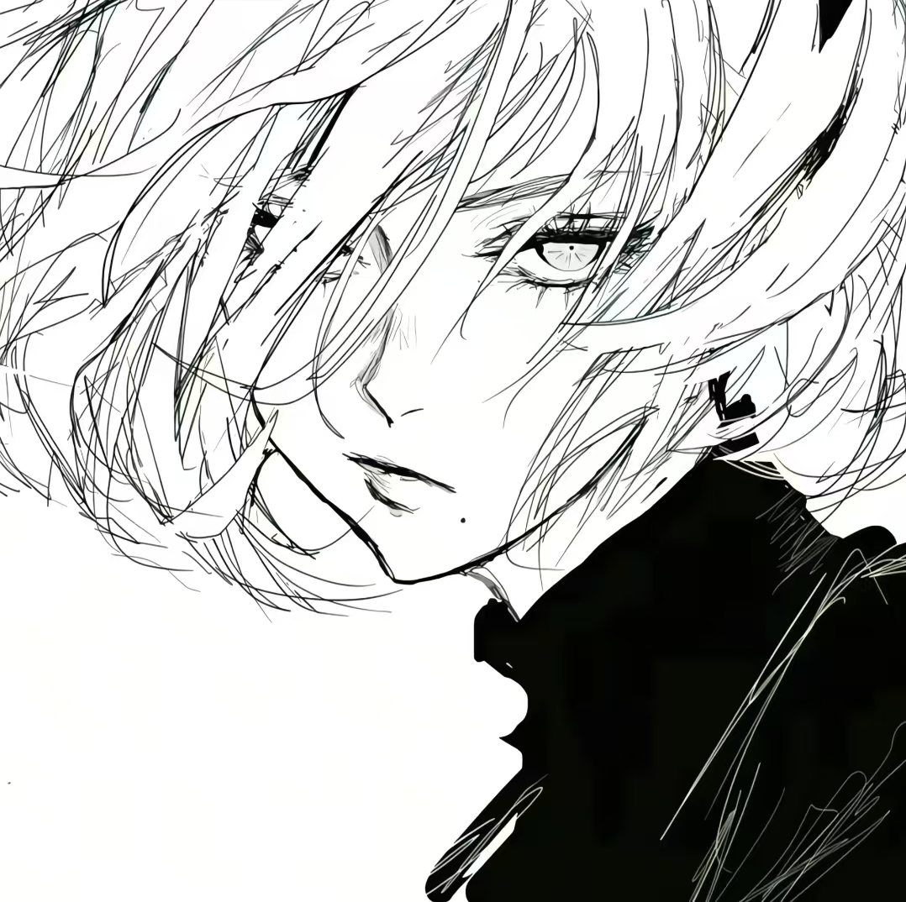
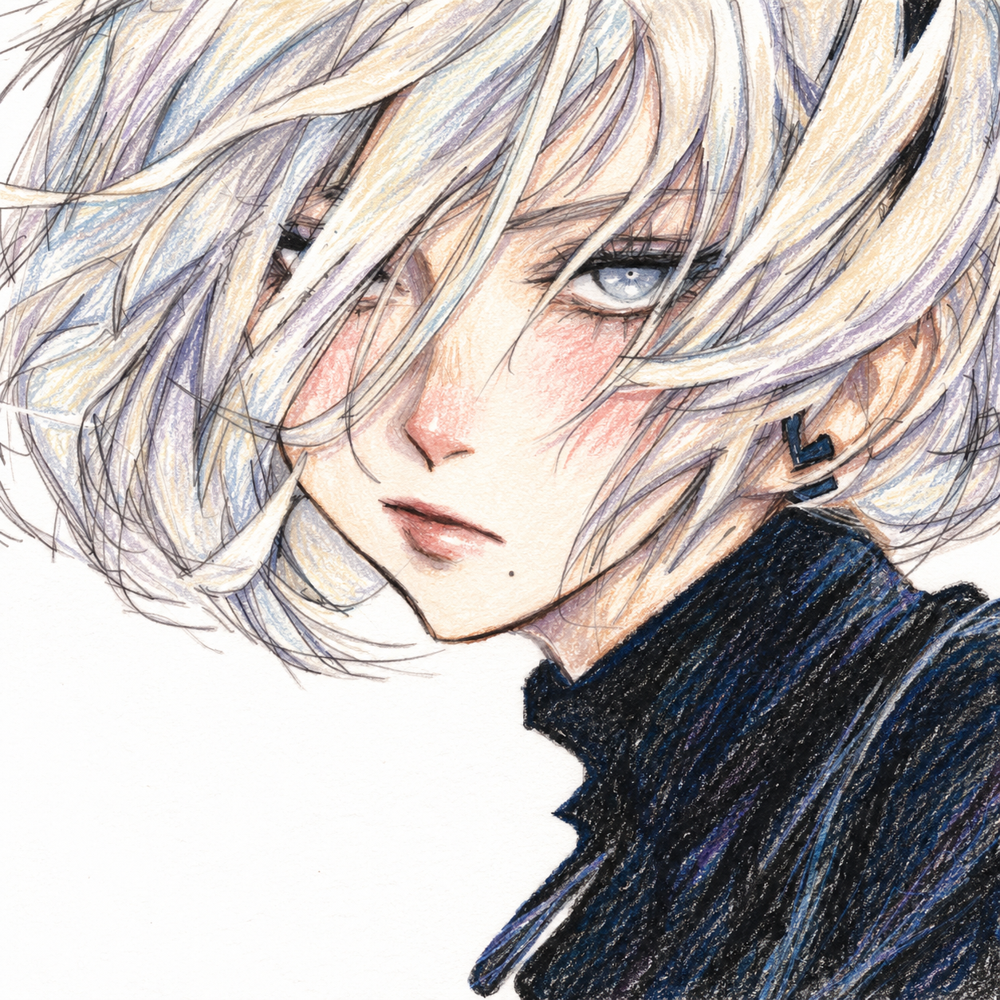
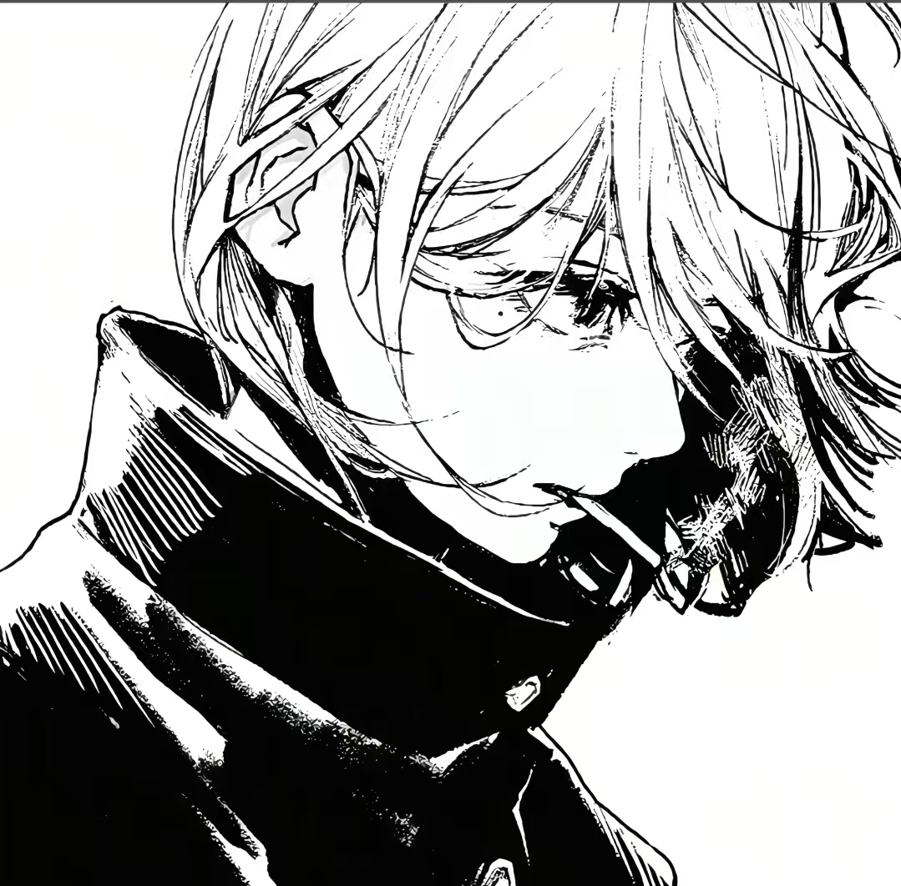
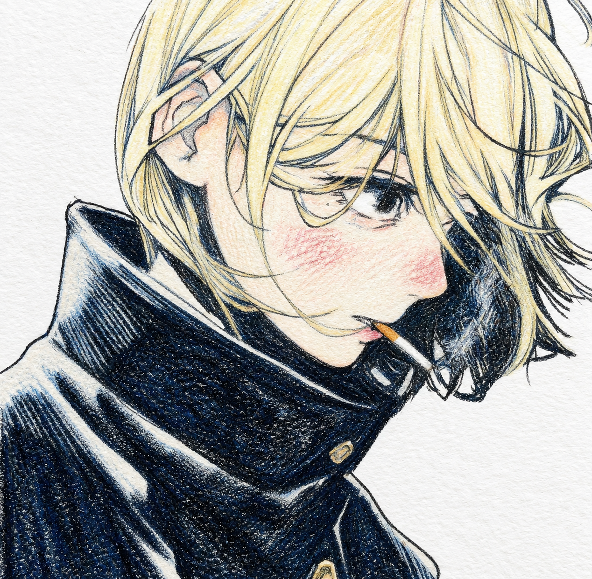

# Crayon-xin

**Universal Crayon Style Transfer · 通用蜡笔画风格转换 Skill**

上传一张图片，将它转换为细密纸齿、柔和叠色、自然手绘笔触的蜡笔画。保留原有构图，按画面中的主体、部件与材质分别处理颜色，支持人像、风景、建筑、动物、植物、静物与混合场景。

单张源图即可开始；也可以附上效果参考，让 Agent 进一步匹配笔触、配色和纸感。

## 效果预览

以下为两组实际转换示例。左侧是黑白线稿原图，右侧是经过分区补色与蜡笔风格化的结果；点击图片可查看大图。

| 原图 | 蜡笔效果 |
| --- | --- |
|  |  |
|  |  |

- **示例一**：浅银灰发束叠加冷暖阴影，灰蓝眼睛、淡暖肤色、玫粉腮红与深色耳饰分别着色，保留原有眼形、发丝遮挡和面部小痣。
- **示例二**：浅金头发、蓝黑衣料、暖金扣件以及香烟的白纸与赭色部分分别表现，面颊、鼻尖和唇部的暖色也有轻重区别。

这些配色是对黑白线稿的艺术补色，不代表原图具有这些固有色。示例中的发色、服装颜色不会固定套用到其他图片。

## 风格特点

- **细密蜡笔质感**：薄层叠色、随形短笔触、略断续的细轮廓与白纸齿纹；浅色通透，深色保持密实层次。
- **按部件与材质配色**：分别处理头发、皮肤、眼睛、衣物、耳饰及原有小道具；风景、动物和静物同样按各自区域处理。
- **保留原有结构**：以源图的构图、取景、透视、主体轮廓及遮挡关系为依据，漫画线稿保留原眼形和表情。
- **锁定背景与环境**：白底保持中性白；风景保留天空、地面、远景和光影层次，避免被替换为单一背景色。
- **生成后再检查**：读取结果，核对构图、配色、背景和笔触；有效果参考时，同时检查风格接近程度。

默认风格偏细腻轻彩。需要更粗犷的油画棒笔触时，可以在请求中明确说明。完整规范见 [风格指南](references/style-guide.md)。

## 快速开始

1. 将本仓库下载或克隆到所用 Agent 的技能目录，保持 `SKILL.md` 与 `references/` 的相对位置。
2. 在聊天中附上待转换的图片。
3. 指定使用本 Skill，并说明需要保色、补色或匹配某张效果参考。

直接使用的请求示例：

> 用 Universal Crayon Style Transfer 把这张图转成蜡笔风，保留构图和背景，按不同主体与材质配色，生成后先自检再展示。

有风格参考时：

> 第一张是待转换原图，第二张是效果参考。保留第一张的构图和内容，匹配第二张的蜡笔笔触、配色关系与纸感。

**Codex**：技能文件夹可放入 `~/.codex/skills/universal-crayon-style-transfer/`，在新会话中附图并使用 `$universal-crayon-style-transfer`；也可直接提供 `SKILL.md` 的路径让 Agent 读取。

**Muse / 其他 Agent**：放入对应技能目录，由宿主实际可用的参考图编辑工具执行。`skill.yaml` 提供描述与检索词，特定宿主的导入格式仍需以其 schema 为准。

本仓库提供规则与参考资料，运行时需要宿主具备图像编辑能力。

## 配色如何选择

| 输入或要求 | 处理方式 |
| --- | --- |
| 彩色照片或插画 | 默认保留原色相、主色块与明暗关系，再进行蜡笔化表现 |
| 黑白线稿，未要求保持黑白 | 按主体、部件与材质进行协调的艺术补色，保留原有明暗分组 |
| 明确要求黑白 | 全图保持灰度，腮红也使用灰度表现 |
| 附有效果参考 | 源图决定内容与构图，参考决定笔触、配色组织和纸感 |

人像腮红只作用于可辨的人脸，动物、物品和风景不会被添加人类五官。白色背景可以保留细微白纸纹理；明确要求纯色 `#FFFFFF` 时，使用无纹理底色约束。

## 自检与修正

每张结果都需要实际读取后检查：

1. 构图、主体数量、轮廓、透视与取景是否对应源图。
2. 背景、环境色调和明暗关系是否符合所选模式。
3. 各部件是否分别配色，笔触与纸感是否清晰且不过度。
4. 人脸、建筑、动物或物品的对应特征是否保留。

初次出图成功但视觉不合格时，最多进行一次明确修正，并再次读取检查。工具直接失败、结果不可读或修正后仍不合格时停止；可由用户选择详细风格指南，或同题材的同风格原创画面。

效果会受源图与宿主模型影响，自检不等于像素级还原。本页展示两组人像线稿案例，尚未对全部题材进行系统测试。

## 文件结构

| 文件 / 目录 | 用途 |
| --- | --- |
| [SKILL.md](SKILL.md) | 主流程、主体路由、配色模式、自检与停止条件 |
| [skill.yaml](skill.yaml) | 名称、简介和检索词 |
| [references/style-guide.md](references/style-guide.md) | 笔触、题材表现、背景锁定与检查清单 |
| [references/examples/](references/examples/) | 本页两组原图与蜡笔结果，用于效果展示与对照 |
| [LICENSE](LICENSE) | 仓库现有的 MIT 许可证 |

示例图片用于展示转换效果，不会在每次使用 Skill 时自动作为内容输入。需要匹配示例风格时，可明确指定该图片为风格参考。

## 许可证

技能文档与配置采用 [MIT License](LICENSE)。
